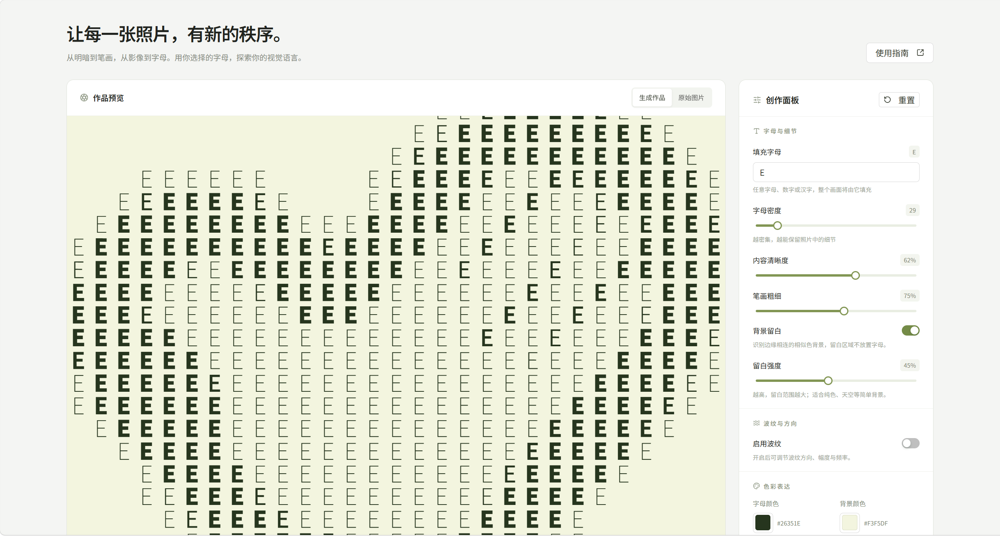

# Fill-Letter · 字母视觉实验室

让每一张照片，有新的秩序。Fill-Letter 会把照片的明暗映射为指定字母的笔画粗细，用成千上万个字符重构出一张有秩序的视觉作品。纯浏览器端运行，照片不出本机。



## 特性

- **填充字母**：任意字母、数字或汉字作为填充字符，明暗自动映射为笔画粗细（可变字重 100–900）
- **字母与细节**：密度、内容清晰度、笔画粗细三个维度控制画面保留多少细节
- **波纹与方向**：可选横向 / 纵向 / 斜向波纹，调节幅度与频率，字母支持 0°/90°/180°/270° 朝向
- **色彩表达**：自定义字母与背景颜色，支持反转明暗
- **背景留白**：自动识别边缘相连的相似色背景并留白，强度可调，带内容色保护（浅色 Logo 等不会被误省略）
- **一键导出 SVG**：按原图尺寸输出，矢量无限缩放，可开启透明背景

所有处理均在浏览器本地完成，照片不会上传到任何服务器。

## 快速开始

无需构建、无需安装依赖，本地任意静态服务器指向 `dist/` 即可：

```bash
# 方式一：自带的小型静态服务器（http://127.0.0.1:4173）
node serve.cjs

# 方式二：其他任意静态服务器，例如
npx serve dist
# 或
python -m http.server 8080 --directory dist
```

然后浏览器打开对应地址，上传一张 JPG / PNG / WebP（≤ 20 MB）或直接拖入预览区即可开始。

## 使用指南

1. **上传**：点击预览区选择照片，或直接拖入。
2. **字母与细节**：指定填充字符，用密度、清晰度、粗细决定保留多少细节；开启「背景留白」可让主体外留白。
3. **波纹与方向**：开启波纹让排列产生流动感，可调方向、幅度、频率与字母朝向。
4. **色彩表达**：设定字母与背景颜色，也可反转明暗。
5. **导出**：点击「导出作品 SVG」一键保存，尺寸与原图一致，可无限缩放；也可开启透明背景。

首次访问会自动弹出使用说明。

## 目录结构

```
fill-letter/
├── dist/              # 全部前端产物（纯静态，无构建步骤）
│   ├── index.html
│   ├── app.js         # 应用逻辑：参数状态、预览渲染、导出
│   ├── background.js  # 背景色检测与留白掩码
│   ├── icons.js       # 图标组件
│   ├── style.css
│   └── vendor/        # 本地化的 React / antd / dayjs / lucide
└── serve.cjs          # 开发用静态服务器（127.0.0.1:4173）
```

## 技术说明

- 界面基于 **React 18 + Ant Design**，依赖已本地化到 `dist/vendor/`，离线可用；字体通过 CDN 加载 Noto Sans SC 可变字体。
- 预览按显示分辨率 1.5 倍超采样渲染（上限 2400px），保证位图清晰度；采样结果与背景掩码均有缓存，调参实时无卡顿。
- 导出为 SVG `<text>` 集合，字符坐标、字重、字号由网格采样结果生成。
